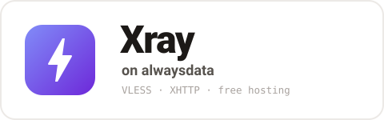
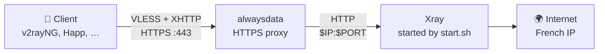

<p align="center">
  
</p>

<p align="center">
  <b>Your own VLESS proxy on free hosting in a single command. No VPS, no payment card.</b>
</p>

<p align="center">
  <a href="https://github.com/AppsGanin/alwaysdata-xray/stargazers"></a>
  <a href="https://github.com/XTLS/Xray-core/releases"></a>
  
  <a href="https://www.alwaysdata.com"></a>
  <a href="LICENSE"></a>
</p>

<p align="center">
  <a href="#-quick-start">🚀 Quick start</a> &nbsp;·&nbsp; <a href="#-clients">📱 Clients</a> &nbsp;·&nbsp; <a href="#-faq">❓ FAQ</a> &nbsp;·&nbsp; <a href="#-support-the-project">💝 Support</a>
</p>

<p align="center">
  ⭐ <b>If the project helped you, give it a star! It's free and really keeps it going.</b>
</p>

A personal [Xray](https://github.com/XTLS/Xray-core) proxy (VLESS over XHTTP) on the free
[alwaysdata](https://www.alwaysdata.com) plan. Clients connect to `https://<account>.alwaysdata.net`,
traffic exits to the internet from a French alwaysdata IP.

> [!WARNING]
> The alwaysdata free plan forbids proxies, so the account may get suspended at any time. Keep a [fallback](#️-where-to-get-a-fallback-server).

## ✨ Features

- 💸 **Free:** runs on the alwaysdata free plan, no VPS to rent or maintain
- 🔒 **Real HTTPS:** alwaysdata serves the certificate for `<account>.alwaysdata.net`, Xray sits behind its proxy
- ⚡ **One command:** installs from macOS, Linux or Windows over a single SSH connection, so the password is asked once
- ✅ **Verified download:** the Xray archive is checked against the SHA-256 from its release
- 🔁 **Safe re-runs:** re-running the install updates Xray and the scripts, the UUID, path and link stay the same
- 🤫 **No access log:** Xray logs warnings only, connections are not recorded

## 🧭 How it works



The alwaysdata site runs `start.sh` as a *User program*. The script builds the Xray config from `secrets.env`
and the `IP` / `PORT` that alwaysdata assigns, then starts Xray.

## 🚀 Quick start

**You need:** an alwaysdata account and `ssh` + `tar` on your computer (built into macOS, Linux and Windows 10/11).

**1. Enable SSH** in the alwaysdata panel: *Remote access → SSH*.

**2. Run the installer** from this folder:

```bash
# macOS / Linux
./install.sh <account>@ssh-<account>.alwaysdata.net
```

```bat
:: Windows 10/11
install.cmd <account>@ssh-<account>.alwaysdata.net
```

It uploads `start.sh` and `setup.sh`, installs the newest Xray, checks the config and prints your link:

```text
Configuration OK.
Site: User program, command /home/<account>/start.sh (restart the site after updates)
vless://<uuid>@<account>.alwaysdata.net:443?encryption=none&security=tls&…&mode=packet-up#<account>
```

**3. Point the site at Xray.** In the panel: *Web → Sites* → edit `<account>.alwaysdata.net`:

| Field             | Value                      |
| ----------------- | -------------------------- |
| Type              | **User program**           |
| Command           | `/home/<account>/start.sh` |
| Working directory | `/home/<account>`          |

**4. Import the `vless://…` link** into your client. Done 🎉

> [!TIP]
> Lost the link? It is saved on the server:
>
> ```bash
> ssh <account>@ssh-<account>.alwaysdata.net cat link.txt
> ```

## 📱 Clients

XHTTP needs an Xray-based client.

| Client                             | Core     | XHTTP           |
| ---------------------------------- | -------- | --------------- |
| v2rayNG, Happ, v2RayTun, Streisand | Xray     | ✅ works         |
| Hiddify, NekoBox, etc.             | sing-box | ⚠️ may not work |

## 🔄 Update

Re-run the install, then restart the site in the panel. That updates Xray to the newest release and the scripts
to your local copies. Secrets are kept, the link stays the same.

**Need new secrets** (e.g. the link leaked)? Delete `~/secrets.env` on the server, re-run the install and restart
the site. You get a new UUID, path and link.

## 🗑️ Uninstall

Change the site type back in the panel (or delete the site), then:

```bash
ssh <account>@ssh-<account>.alwaysdata.net "rm -f xray setup.sh start.sh config.json secrets.env link.txt"
```

## ❓ FAQ

<details>
<summary><b>Why XHTTP mode <code>packet-up</code>?</b></summary>

The alwaysdata proxy breaks `stream-up` and `stream-one`. The server accepts any mode, the link tells the client
to use `packet-up`.

</details>

<details>
<summary><b>Why a pre-release Xray?</b></summary>

`setup.sh` installs the newest Xray release, pre-releases included (v26.9.9 as of September 2026).
`start.sh` lists the VLESS user under `users`, which Xray reads only since v26.5.9, and GitHub's latest stable
release (v26.3.27) is older.

A future release may change the config format again, so check the relay after updating.

</details>

<details>
<summary><b>Will the account stay alive?</b></summary>

Not guaranteed. Proxies are against the free plan's rules, and free accounts are also suspended if you don't log
into the panel for 120 days.

</details>

> [!IMPORTANT]
> Log into the alwaysdata panel at least once every 120 days, otherwise the free account is suspended.

## 🖥️ Where to get a fallback server

alwaysdata can suspend the free account at any time. For something reliable, rent the cheapest VPS
(1 vCPU, 1 GB RAM, any Linux) and run [RosPanel](https://github.com/AppsGanin/rospanel) on it:
a self-hosted Xray panel from the same author, installed with one command.

**If you haven't picked a host yet, sign up through the links below.** It's a free way to
support the project: the price is the same for you, and a share of the rent goes into development.

[VDSina](https://www.vdsina.com/?partner=nmzki7z7tu) ·
[Aeza](https://aeza.net/?ref=375522) ·
[NetGrid](https://netgrid.host/ru?from=3491) ·
[Serv.host](https://serv.host/?from=36809) ·
[u1Host](https://u1host.com/?from=7702) ·
[Waicore](https://waicore.net/?from=35607)

Thanks to everyone who signs up through them 🙏

## 💝 Support the project

The project is developed in spare time and distributed for free. If it turned out to be useful,
the easiest way to support it is
**[DonationAlerts](https://www.donationalerts.com/r/dmitryapp)** or
**[Boosty](https://boosty.to/githubapps)** (RU cards, one-off or recurring). Thank you! 🙏

<b>Crypto</b>


**USDT.** Pick a network and copy the address **carefully** — the sender's and the receiver's
network must match. Send **USDT** only, and only on the network listed: a transfer on the wrong
network cannot be recovered. The cheapest fees are on **TRON (TRC20)** and **TON**.

| Network          | Token | Address                                            |
| ---------------- | ----- | -------------------------------------------------- |
| TRC20 (Tron)     | USDT  | `TJwyrPVEZVZ1YrcmDiZTyFjLo3Q2DmEGzs`               |
| ERC20 (Ethereum) | USDT  | `0xf9d663146ce902da91911b214c71cc73a5269d1d`       |
| Solana           | USDT  | `2qAZRTbaUMTfYuZbD1dCYHjkYgxkw4dUYE9XY3JhC2Cs`     |
| TON              | USDT  | `UQDoat731MLYuIw8ayL3Vhhw7zTBbLvRaQFmDvab--CNNI7e` |

**Bybit.** If you're on Bybit too — transfer to UID `136462734`: instant and free.

**Can't support financially?** Give the project a ⭐ star, or rent a server through the links in
[Where to get a fallback server](#️-where-to-get-a-fallback-server). Both cost you nothing and help a lot.
Found a bug or have an idea? Open an [issue](https://github.com/AppsGanin/alwaysdata-xray/issues) or a PR.

<p align="center">
  <a href="https://github.com/AppsGanin/alwaysdata-xray/stargazers"></a>
</p>

## 📄 License

[MIT](LICENSE) © 2026 Dmitry Ganin
