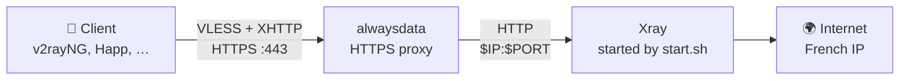

<p align="center">
  
</p>

<p align="center">
  <b>Your own VLESS proxy on free hosting in a single command. No VPS, no payment card.</b>
</p>

<p align="center">
  <a href="https://github.com/AppsGanin/alwaysdata-xray/stargazers"></a>
  <a href="https://github.com/XTLS/Xray-core/releases"></a>
  
  <a href="https://www.alwaysdata.com"></a>
  <a href="LICENSE"></a>
</p>

<p align="center">
  <a href="#-quick-start">🚀 Quick start</a> &nbsp;·&nbsp; <a href="#-clients">📱 Clients</a> &nbsp;·&nbsp; <a href="#-faq">❓ FAQ</a> &nbsp;·&nbsp; <a href="#-support-the-project">💝 Support</a>
</p>

<p align="center">
  ⭐ <b>If the project helped you, give it a star! It's free and really keeps it going.</b>
</p>

A personal [Xray](https://github.com/XTLS/Xray-core) proxy (VLESS over XHTTP) on the free
[alwaysdata](https://www.alwaysdata.com) plan. Clients connect to `https://<account>.alwaysdata.net`,
traffic exits to the internet from a French alwaysdata IP.


## ✨ Features

- 💸 **Free:** runs on the alwaysdata free plan, no VPS to rent or maintain
- 🔒 **Real HTTPS:** alwaysdata serves the certificate for `<account>.alwaysdata.net`, Xray sits behind its proxy
- ⚡ **One command:** from macOS, Linux or Windows over one SSH connection (the password is asked once), or right on the server
- ✅ **Verified download:** the Xray archive is checked against the SHA-256 from its release
- 🔁 **Safe re-runs:** re-running the install updates Xray and the scripts, the UUID, path and link stay the same
- 🤫 **No access log:** Xray logs warnings only, connections are not recorded

## 🧭 How it works



The alwaysdata site runs `start.sh` as a *User program*. The script builds the Xray config from `secrets.env`
and the `IP` / `PORT` that alwaysdata assigns, then starts Xray.

## 🚀 Quick start

**You need:** an alwaysdata account and `ssh` on your computer (built into macOS, Linux and Windows 10/11).

**1. Enable SSH** in the alwaysdata panel: *Remote access → SSH*.

**2. Run the installer** from this folder (it also needs `tar`, built in as well):

```bash
# macOS / Linux
./install.sh <account>@ssh-<account>.alwaysdata.net
```

```bat
:: Windows 10/11
install.cmd <account>@ssh-<account>.alwaysdata.net
```

Or install right on the server, no need to download this repository. Log in with
`ssh <account>@ssh-<account>.alwaysdata.net` and run:

```bash
cd ~ && { [ ! -f xray ] || mv xray xray.old; } && mkdir -p xray && cd xray && curl -fsSLO "https://raw.githubusercontent.com/AppsGanin/alwaysdata-xray/main/{start,setup}.sh" && bash setup.sh
```

Either way, `start.sh` and `setup.sh` end up in `~/xray`, the newest Xray is installed, the config is checked
and your link is printed:

```text
Configuration OK.
Site: User program, command /home/<account>/xray/start.sh, working directory /home/<account>/xray (restart the site after updates)
vless://<uuid>@<account>.alwaysdata.net:443?encryption=none&security=tls&…&mode=packet-up#<account>
```

**3. Point the site at Xray.** In the panel: *Web → Sites* → edit `<account>.alwaysdata.net`:

| Field             | Value                           |
| ----------------- | ------------------------------- |
| Type              | **User program**                |
| Command           | `/home/<account>/xray/start.sh` |
| Working directory | `/home/<account>/xray`          |

**4. Import the `vless://…` link** into your client. Done 🎉

> [!TIP]
> Lost the link? It is saved on the server:
>
> ```bash
> ssh <account>@ssh-<account>.alwaysdata.net cat xray/link.txt
> ```

## 📱 Clients

XHTTP needs an Xray-based client.

| Client                             | Core     | XHTTP           |
| ---------------------------------- | -------- | --------------- |
| v2rayNG, Happ, v2RayTun, Streisand | Xray     | ✅ works         |
| Hiddify, NekoBox, etc.             | sing-box | ⚠️ may not work |

## 🔄 Update

Re-run the install, then restart the site in the panel. That updates Xray to the newest release and the scripts
to your local copies (or, with the server command, to the latest version on GitHub). Secrets are kept, the link
stays the same.

> [!NOTE]
> Installs before October 2026 lived right in the home folder. The update moves them into `~/xray` (the link stays
> the same) and asks you to change the site's command and working directory to the ones in step 3.

**Need new secrets** (e.g. the link leaked)? Delete `~/xray/secrets.env` on the server, re-run the install and restart
the site. You get a new UUID, path and link.

## 🗑️ Uninstall

Change the site type back in the panel (or delete the site), then:

```bash
ssh <account>@ssh-<account>.alwaysdata.net "rm -rf ~/xray"
```

## ❓ FAQ

<details>
<summary><b>Why XHTTP mode <code>packet-up</code>?</b></summary>

The alwaysdata proxy breaks `stream-up` and `stream-one`. The server accepts any mode, the link tells the client
to use `packet-up`.

</details>

<details>
<summary><b>Why a pre-release Xray?</b></summary>

`setup.sh` installs the newest Xray release, pre-releases included (v26.9.9 as of September 2026).
`start.sh` lists the VLESS user under `users`, which Xray reads only since v26.5.9, and GitHub's latest stable
release (v26.3.27) is older.

A future release may change the config format again, so check the relay after updating.

</details>

<details>
<summary><b>Will the account stay alive?</b></summary>

Not guaranteed. Proxies are against the free plan's rules, and free accounts are also suspended if you don't log
into the panel for 120 days.

</details>

> [!IMPORTANT]
> Log into the alwaysdata panel at least once every 120 days, otherwise the free account is suspended.

## 📄 License

[MIT](LICENSE) © 2026 Dmitry Ganin
